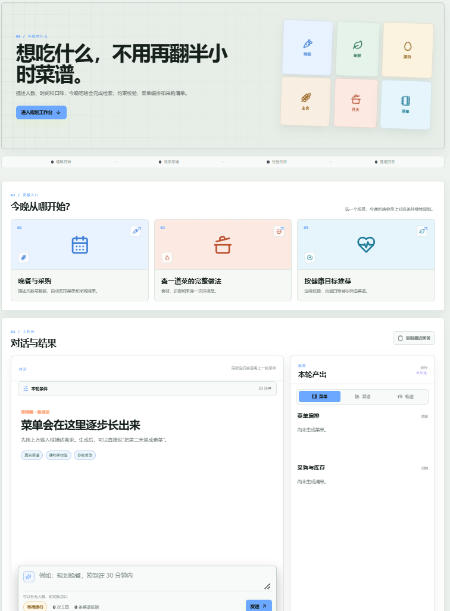
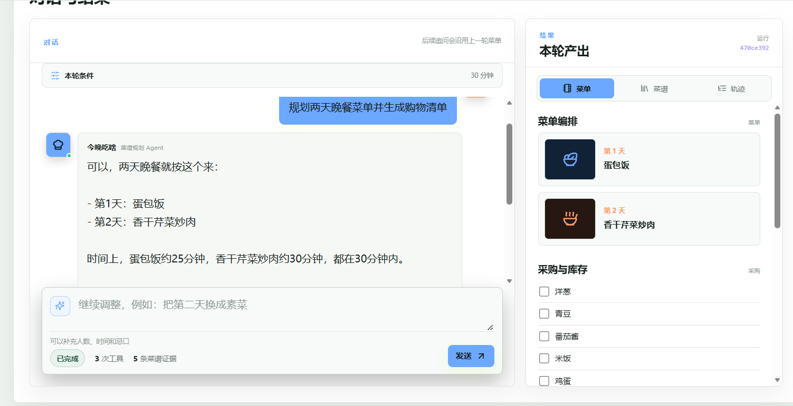
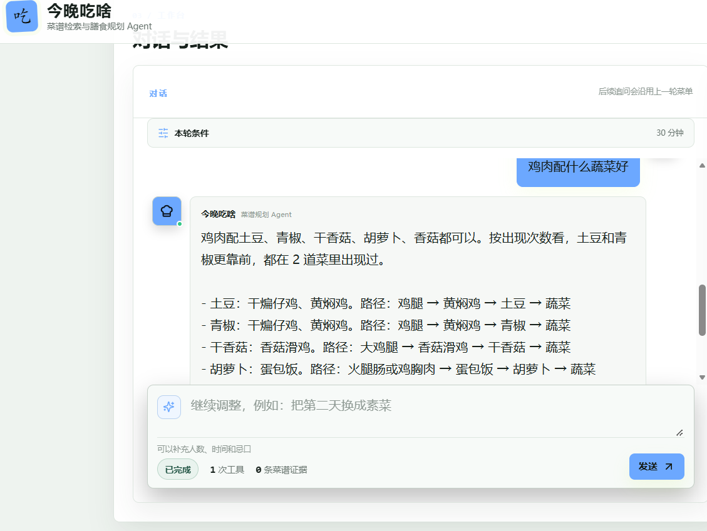
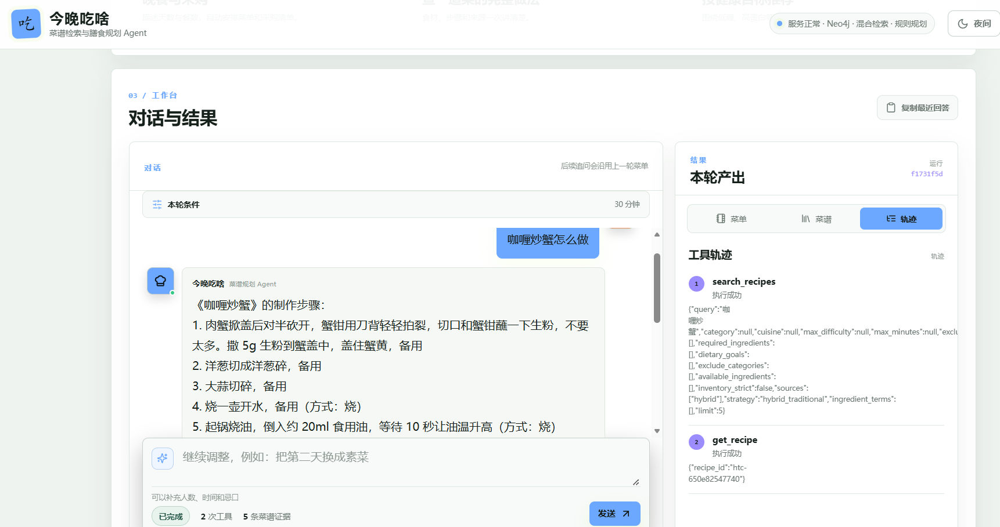

# 今晚吃啥 · 食谱规划 Agent

一个基于 LangGraph、GraphRAG 和可验证工具调用的食谱规划 Agent。

项目目标不是做一个聊天式 RAG 演示，而是实现能够理解约束、规划任务、调用工具、校验结果并执行多步骤目标的领域 Agent。



## 已完成能力

- 强类型 Agent 状态与 LangGraph 多步骤循环
- LLM Planner，以及无模型环境下的规则 Planner 降级
- 工具注册表和统一 Pydantic 工具协议
- 过敏原、忌口、制作时间、难度和库存约束校验
- 餐别过滤和营养目标排序，避免把调料、饮品、甜品当作晚餐主菜
- 菜谱检索、完整步骤读取、多日菜单和购物清单工具
- 购物清单保留食材和调料，过滤厨具、容器、计时工具等非采购项
- 多轮菜单修改与购物清单修改
- SQLite 用户长期画像和 LangGraph SQLite Checkpointer
- 敏感工具人工确认、暂停恢复和 `thread_id` 任务查询
- FastAPI、任务状态查询和响应式 Web 前端
- HowToCook Markdown 解析、知识图谱构建和 Neo4j 导入
- BGE 向量化、Milvus、BM25 和 RRF 混合检索实现
- 实体词典、可选的 LLM 结构化查询解析和统一 Hybrid/图谱召回
- 查询复杂度分析与检索策略路由，区分混合检索、图谱检索和组合检索
- 实体级与主题级图谱召回，与向量、BM25 一起参与 RRF 融合
- 检索通道级降级：向量库或关键词检索单路失败时不影响整条链路
- 确定性可信回答、闲聊自然对话与可选的纯模型答案对照
- 覆盖查询解析、规划、工具、校验和回答的结构化执行 trace
- 食材类别与多跳图推理，支持“鸡肉配什么蔬菜”这类关系问题
- 八大菜系结构化字段和图谱过滤，支持“粤菜呢”这类上下文追问
- 烹饪方法与步骤用具抽取，制作步骤回答会带方式和工具
- 自动化回归测试与真实 Neo4j 场景评测
- Dockerfile 和 Docker Compose 数据服务

当前解析 322 道真实菜谱，并生成 4,322 个图谱节点和 7,078 条关系。

## Agent 流程

```text
plan -> execute -> validate
          ^            |
          |            +-> replan
          |            |
          +------------+-> respond
```

典型菜单任务会依次调用：

```text
search_recipes
  -> create_meal_plan
  -> create_shopping_list
  -> respond
```



过敏原、时间和难度等硬约束会在工具参数和校验节点中再次执行，不能通过提示词删除。
库存表达会区分“只有/仅有”和“现有/手头有”，前者执行严格库存过滤，后者优先按现有食材召回。

## 效果示例

**图谱多跳推理**：问“鸡肉配什么蔬菜”，系统沿图关系遍历给出可回溯的搭配路径，每条路径都能定位到具体菜谱与食材节点。



**菜谱详情与工具轨迹**：回答制作步骤时带上烹饪方式，右侧同步展示工具调用链，执行过程可见。



## 数据来源

菜谱原始内容来自：

- [HowToCook](https://github.com/Anduin2017/HowToCook)
- License: The Unlicense

本项目独立实现 Markdown 数据解析、知识图谱构建、GraphRAG 检索和 Agent 编排。具体来源边界和原创贡献见 [NOTICE.md](NOTICE.md)。

原始菜谱数据未随仓库分发，首次运行前需自行获取：

```powershell
git clone https://github.com/Anduin2017/HowToCook.git data/raw/HowToCook
```

## 本地运行

```powershell
python -m venv .venv
.\.venv\Scripts\Activate.ps1
pip install -e ".[dev]"
pip install -e ".[rag]"
pip install -e ".[observability]"
```

运行单元测试：

```powershell
pytest
```

单元测试默认使用内存菜谱，不依赖 Neo4j、Milvus 或模型 API。

## 安全保存 API Key

不要把 API Key 写入源码、聊天记录或 Git。Windows 下可以使用 DPAPI，让密钥只能由当前 Windows 用户解密：

```powershell
.\scripts\set_llm_key.cmd
.\scripts\run_dev.ps1
```

加密文件保存在 `.secrets/llm.key`，该目录已经加入 `.gitignore`。

## 数据与索引

```powershell
docker compose up -d
python scripts/parse_howtocook.py
python scripts/build_graph.py
python scripts/import_neo4j.py --reset
python scripts/build_vector_index.py
```

启动开发服务：

```powershell
.\scripts\run_dev.ps1
```

Docker 不可用时，可以使用全量菜谱文件检索模式做快速验证：

```powershell
.\scripts\run_dev.ps1 -UseFileSearch
```

该模式读取 322 道菜谱并使用 BM25，支持 Agent、约束和工具回归，但不包含
Neo4j 多跳关系与 Milvus 向量检索。

使用 Docker Compose 启动完整服务时，用下面的脚本解密并注入本机 API Key：

```powershell
.\scripts\run_compose.ps1 -Rebuild
```

默认只启用 LLM 查询解析，Planner 继续使用确定性规则。需要同时启用 LLM Planner 时：

```powershell
.\scripts\run_compose.ps1 -Rebuild -UseLLMPlanner
```

启动后访问：

- Web 页面：http://127.0.0.1:8020
- API 文档：http://127.0.0.1:8020/docs
- 健康检查：http://127.0.0.1:8020/healthz

## Docker

```powershell
docker compose build backend
docker compose up -d
```

Docker 内后端监听 `8000`，宿主机映射到 `8020`，避免和本机其他服务冲突。
Windows 下遇到 Docker Engine 无响应时，参考
[Docker 启动与排障](docs/docker-troubleshooting.md)。

部署到云服务器（规格建议、安全组、国内拉镜像、一键脚本）见
[deploy/README.md](deploy/README.md)。

## 评测

```powershell
python scripts/evaluate_agent.py
```

当前评测集包含 54 条真实 Neo4j 场景。Neo4j 和 Hybrid Retrieval 均完成规则 Planner
回归评测，分别输出任务成功、检索命中、约束满足、引用覆盖和延迟指标。

当前结果：

| 模式 | Planner | 任务成功率 | 平均延迟 |
|---|---|---:|---:|
| Neo4j | RuleBasedPlanner | 100% | 0.03 秒 |
| Hybrid | RuleBasedPlanner | 100% | 0.46 秒 |
| Neo4j | LLMRecipePlanner | 100% | 5.94 秒 |

LLM Planner 使用同一评测集单独运行，报告中会区分模型直接规划和规则降级比例：

```powershell
python scripts/evaluate_agent.py --planner llm --fail-on-fallback `
  --output docs/evaluation-llm.md
```

`--fail-on-fallback` 会在模型规划失败并降级到规则 Planner 时立即停止，
避免规则结果被混入 LLM Planner 指标。

真实 HTTP Agent 可靠性评测：

```powershell
python scripts/evaluate_reliability.py --output docs/reliability.md
```

该评测覆盖库存同义表达、过敏与忌口、冲突菜拦截、多轮追问、菜单规划、无关问题和提示注入。

### 检索方案消融实验

除端到端评测外，项目还对比了不同方案在同一批查询上的效果。所有实验的标准答案
均由菜谱数据独立推导，不调用被测检索代码。

| 实验 | 对比内容 | 结果 | 报告 |
|---|---|---|---|
| 检索质量 | 单路 vs 五路混合召回 | 精准率 0.485 → 0.776，召回率 +53% | [报告](docs/retrieval-ablation.md) |
| 元数据过滤 | 纯语义 vs 硬过滤 | 约束满足率 0.600 → 0.867 | [报告](docs/filter-ablation.md) |
| 过敏原约束 | 提示词声明 vs 硬约束 | 违规推荐率 10% → 0% | [报告](docs/safety-ablation.md) |
| 降级鲁棒性 | 正常 vs 向量库故障 | 可用率 100%，精度仅降 4.8% | [报告](docs/degradation-ablation.md) |
| 查询路由 | 固定策略 vs 按复杂度路由 | 路由精度低于全通道（已记录结论） | [报告](docs/routing-ablation.md) |
| 搭配问答 | 图谱 vs 向量检索 | 图谱方案优于纯向量 | [报告](docs/pairing-ablation.md) |

```powershell
python scripts/evaluate_retrieval.py
python scripts/evaluate_filters.py
python scripts/evaluate_safety.py
python scripts/evaluate_degradation.py
python scripts/evaluate_routing.py
python scripts/evaluate_pairing.py
```

## 持续集成

推送代码或创建 Pull Request 时，GitHub Actions 会自动执行：

- `pytest`
- `ruff check`
- `ruff format --check`
- `docker compose config`
- Docker 后端镜像构建

## 全链路追踪

项目内置标准 OpenTelemetry 追踪，默认关闭，不影响本地测试。开启后会记录：

- HTTP 请求和 `thread_id`
- 查询解析意图
- Planner 决策
- 工具名称、执行结果和耗时
- 约束校验错误数量
- LLM token 用量
- 最终任务状态、菜单和购物清单数量

使用控制台 exporter 快速验证：

```powershell
$env:OTEL_ENABLED = "true"
$env:OTEL_EXPORTER = "console"
.\scripts\run_dev.ps1
```

使用 Jaeger 查看可视化链路：

```powershell
$env:OTEL_ENABLED = "true"
$env:OTEL_EXPORTER = "otlp"
docker compose --profile observability up -d jaeger
docker compose up -d backend
```

Jaeger 页面：http://127.0.0.1:16686

## 文档

- [架构说明](docs/architecture.md)
- [评测报告](docs/evaluation.md)
- [混合检索评测](docs/evaluation-hybrid.md)
- [LLM Planner 评测](docs/evaluation-llm.md)
- [可靠性评测](docs/reliability.md)
- [检索方案消融实验](docs/retrieval-ablation.md)
- [元数据过滤实验](docs/filter-ablation.md)
- [过敏原约束实验](docs/safety-ablation.md)
- [降级鲁棒性实验](docs/degradation-ablation.md)
- [查询路由实验](docs/routing-ablation.md)
- [搭配问答实验](docs/pairing-ablation.md)
- [Docker 启动与排障](docs/docker-troubleshooting.md)

## 后续路线

- 补充演示视频和最终截图
